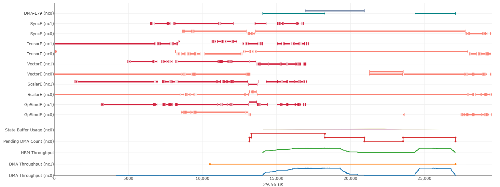
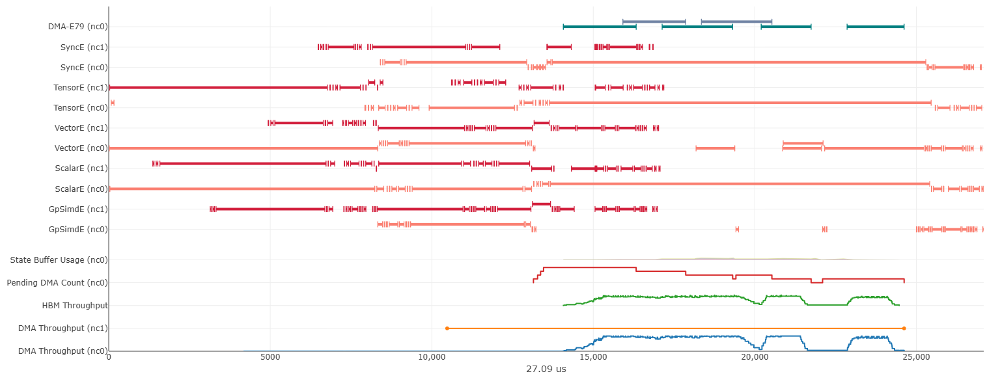

## Part 1: Vector Add and Matrix Transpose

### Step 1: Chunking Vectors to Parallelize Across 128 Compute Lanes (6 points)

**Q1.** Run `vector_add_tiled` with *row_chunk = 1* on a vector size of 25600
(`python run_benchmark.py --kernel tiled -n 25600`). What was the execution time
in microseconds (μs)?

**Answer:**

- `row_chunk = 1`, n = 25600 → **38216 μs** (≈ 38.2 ms)

---

**Q2.** Change `vector_add_tiled` to use *row_chunk = 128*. Record the execution
time (μs) on a vector size of 25600. How much faster is *row_chunk = 128* compared
to *row_chunk = 1*? Why do you think it is faster?
*(Hint: think of execution as loading `ROW_CHUNK` elements in parallel from HBM,
then doing a `ROW_CHUNK`-wide vector add in SBUF.)*

**Answer:**

| ROW_CHUNK | Time (μs) on n=25600 |
|---|---|
| 1 | 38216 |
| 128 | 402 |

- Speedup (1 → 128): **≈ 95×** (38216 / 402)
- Why faster: two effects compound, both stemming from the fact that the
  per-operation cost is roughly **fixed regardless of how much data the
  operation touches**:
  1. **Full 128-lane parallelism.** The Vector Engine is a 128-partition SIMD
     unit whose lanes are clocked together, so a `tensor_scalar` add on a
     `(128,1)` tile takes essentially the same time as on a `(1,1)` tile but
     produces 128 results instead of 1. With `ROW_CHUNK=1`, 127 of 128 lanes
     sit idle every instruction.
  2. **128× fewer DMA transfers.** Each `nisa.dma_copy` pays a fixed
     setup/descriptor overhead independent of size. `ROW_CHUNK=1` issues 25600
     tiny DMAs (overhead-dominated); `ROW_CHUNK=128` issues only
     `25600/128 = 200`, amortizing that overhead over 128 elements each.

  This is visible in the per-iteration cost: 38216 μs / 25600 ≈ 1.49 μs per
  iteration vs 402 μs / 200 ≈ 2.0 μs — roughly constant whether an iteration
  processes 1 or 128 elements. So the win comes almost entirely from doing 128×
  fewer iterations. (The speedup is ~95×, short of an ideal 128×, due to
  residual compile/loop-control/bandwidth overheads.)

---

**Q3.** Try running `vector_add_tiled` with *row_chunk = 256* on a vector size of
25600. You should see an error. In one sentence, explain why.

**Answer:** `ROW_CHUNK=256` tries to allocate an SBUF tile with 256 partitions
(`nl.ndarray((ROW_CHUNK, 1), ..., buffer=nl.sbuf)`), but a NeuronCore's SBUF has a
hard architectural limit of 128 partitions on the first (partition) dimension, so
allocation fails with `ValueError: number of partitions 256 exceed architecture
limitation of 128`.

---

### Step 2a: Improved Data Streaming (4 points)

**Q1.** Run `vector_add_stream` with *FREE_DIM = 2*. How many μs did it take on a
vector size of 25600? How much faster is this than `vector_add_tiled` with
*row_chunk = 128* from Step 1?

**Answer:**

- `stream`, FREE_DIM = 2, n = 25600 → **196 μs**
- Speedup vs `tiled` (row_chunk=128, 402 μs): **≈ 2.05×** (402 / 196)

---

**Q2.** Change *FREE_DIM* to reduce the number of DMA transfers as much as possible
on a vector of size 25600. What value of *FREE_DIM* did you choose, and what was the
execution time (μs)? How much faster is your chosen *FREE_DIM* than *FREE_DIM = 2*?
How much faster than `vector_add_tiled` with *row_chunk = 128*?

**Answer:**

- Chosen FREE_DIM: **200**. Reasoning: the vector is reshaped to
  `(PARTITION_DIM, M/PARTITION_DIM) = (128, 25600/128) = (128, 200)`, so the free
  dimension has 200 columns. Setting `FREE_DIM = 200` makes the loop run
  `25600 / (128 * 200) = 1` iteration — the whole `(128, 200)` tile is loaded in a
  single DMA per input, which is the minimum possible number of DMA transfers.
  (`FREE_DIM` must divide 200, so the largest legal value is 200 itself.)
- Time (μs): **15 μs**
- Speedup vs FREE_DIM = 2 (196 μs): **≈ 13×** (196 / 15)
- Speedup vs `tiled` row_chunk=128 (402 μs): **≈ 27×** (402 / 15)

**Supporting sweep** (powers of two + the divisor 200; `FREE_DIM` must divide 200,
so 16/32/64/128 are skipped — they drop the uncovered tail columns and fail
correctness):

| FREE_DIM | loop iters | time (μs) |
|---|---|---|
| 1 | 200 | 388 |
| 2 | 100 | 196 |
| 4 | 50 | 103 |
| 8 | 25 | 57 |
| 200 | 1 | 15 |

The trend has two regimes: in the overhead-dominated region (FREE_DIM 1→8) the
time roughly halves each time FREE_DIM doubles, i.e. time ∝ iterations ∝
1/FREE_DIM, because runtime is dominated by per-DMA/per-instruction fixed overhead
paid once per iteration. Past that, returns diminish (8→200 cuts iterations 25×
but time only ~3.8×) as the cost floor shifts to the actual data movement and
vector-add work rather than fixed overhead.

---

### Step 2b: Learning to Use Neuron-Profile (5 points)

**Q1.** Generate profiles for *FREE_DIM = 2000* and *FREE_DIM = 1000* on a vector
size of 256000, saving `.neff` / `.ntff` files (`stream_256k_fd2k`,
`stream_256k_fd1k`). *(No written answer required — this step produces the trace
files used below.)*

**Answer:** Four trace files generated:

- `stream_256k_fd2k.neff`, `stream_256k_fd2k.ntff` (FREE_DIM = 2000)
- `stream_256k_fd1k.neff`, `stream_256k_fd1k.ntff` (FREE_DIM = 1000)

Benchmark wall-clock (from `run_benchmark.py`): FREE_DIM=2000 → 25 μs, FREE_DIM=1000 → 23 μs.

---

**Q2.** Using `neuron-profile view --output-format summary-text ...`, report:

**Answer:**

| FREE_DIM | total_time (s) | dma_transfer_count |
|---|---|---|
| 2000 | 2.8340789e-05 (≈ 28.3 μs) | 3 |
| 1000 | 2.6665792e-05 (≈ 26.7 μs) | 6 |

The key observation: **FREE_DIM = 1000 is faster (26.7 μs) despite issuing twice as
many DMA transfers (6 vs 3).** DMA counts match the loop structure — FREE_DIM=2000
runs 1 iteration (2 loads + 1 store = 3 DMAs); FREE_DIM=1000 runs 2 iterations
(4 loads + 2 stores = 6 DMAs).

---

**Q3.** Launch the GUI analytics for both *FREE_DIM = 2000* and *FREE_DIM = 1000*
and inspect the engine timeline (color by Instruction Type; hide individual
NeuronCore layout and expanded DMA). On the **DMA** lane, count the DMA
instructions — does it match the expected number of `nisa.dma_copy` calls? Also
note the **VectorE** (the `nisa.tensor_tensor` add), **Pending DMA Count**, and
**DMA Throughput** lanes (these feed Q4).

**Answer:**

GUI launched for both profiles (clean view: DMA collapsed, no individual
NeuronCore layout). Screenshots saved under
[`artifacts/experiments/part1/2b/`](artifacts/experiments/part1/2b/):

**FREE_DIM = 2000** (1 iteration, `total_time` ≈ 29.56 μs):

**FREE_DIM = 1000** (2 iterations, `total_time` ≈ 27.09 μs):

**DMA instruction count vs. expected `nisa.dma_copy` calls — they match.**
`vector_add_stream` issues **3 `dma_copy` per loop iteration** (load `a_tile`,
load `b_tile`, store `res`), and the loop runs `256000 / (128 * FREE_DIM) =
2000 / FREE_DIM` iterations:

| FREE_DIM | iterations | expected `dma_copy` (3 × iters) | profiler `dma_transfer_count` |
|---|---|---|---|
| 2000 | 1 | 3 | 3 ✅ |
| 1000 | 2 | 6 | 6 ✅ |

So the logical DMA-transfer count exactly equals the number of `nisa.dma_copy`
calls. (Note: with *Show expanded DMA* on, each logical transfer is fanned out
across the 16 DMA engines `DMA-E64…E79` as many sub-packets, so the *visual* bar
count per engine is much larger than 3/6 — the authoritative logical count is the
`dma_transfer_count` metric.)

Other lanes: **VectorE** carries the `tensor_tensor` adds; **Pending DMA Count**
spikes when loads are in flight; **DMA Throughput** is the key lane for Q4 — for
FREE_DIM=2000 it shows two separated humps (load, then store) with the throughput
dropping to **zero** in between (pure compute, no overlap), whereas for
FREE_DIM=1000 that gap is partially filled (DMA still moving while the Vector
Engine computes).

---

**Q4.** Briefly explain why *FREE_DIM = 1000* has a faster execution time than
*FREE_DIM = 2000* even though it required more DMA transfers. *(Hint: pipelining.)*

**Answer:** `FREE_DIM = 2000` minimizes the raw number of DMA transfers, but it
does all of the work as one very large tile. That leaves little opportunity for
the DMA engines and Vector Engine to overlap: the kernel must load a large tile,
run the vector add, and then store the result, so the engine timeline has longer
stretches where one part of the pipeline is active while the others are waiting.

With `FREE_DIM = 1000`, the work is split into two smaller tiles. This doubles
the DMA count from 3 to 6, but it gives the hardware/compiler more opportunity to
pipeline the loop iterations: DMA for one tile can overlap with VectorE work or
stores for another tile. In the profiler timeline this shows up as better overlap
between the DMA lanes and the VectorE lane, with less idle time between stages.
So even though there are more DMA instructions, the smaller tile size keeps the
engines busier and reduces total end-to-end latency.

---

### Step 3: Matrix Transpose (15 points = 10 coding + 5 writeup, +1 EC)

> Code deliverable: implement `matrix_transpose` in `part1/kernels.py` using only
> `nisa.nc_transpose` for compute (memory ops like `dma_copy` / `tensor_copy` are
> allowed). Tiles are ≤ 128×128; M and N are both divisible by 128.

**Q1.** Test on a 1024×1024 matrix (`python run_benchmark.py --kernel transpose -n 1024`)
and record the execution time (μs).

**Answer:**

- `transpose`, 1024×1024 → **91 μs** (correctness passed). This is the initial
  straightforward per-tile implementation; the committed kernel is later optimized
  in Q3 (which runs the same 1024² case in 65 μs).

---

**Q2.** Without using a profiler, do you think your kernel is memory-bound or
compute-bound? Explain. Then confirm by profiling (as with `vector_add_stream`).
You may include a screenshot, but provide a written description of how it validates
your answer.

**Answer:**

- **Prediction (before profiling): memory-bound.** A transpose performs **zero
  arithmetic (0 FLOPs)** — it only relocates elements. The whole matrix is read
  HBM→SBUF once and written SBUF→HBM once (≈ 2× the matrix size of HBM traffic),
  with no compute to hide that movement behind. So runtime should be limited by
  HBM/DMA bandwidth, not engine arithmetic throughput.

- **Profiling evidence (confirms memory-bound).** Profiled the 1024×1024 run
  (`--profile_name`) and read engine activity from
  `neuron-profile view --output-format summary-text`:

  | engine | active-time % | active time |
  |---|---|---|
  | **DMA** | **60.9 %** (busiest) | 28.75 μs |
  | Tensor Engine | 33.3 % | 15.73 μs |
  | Vector Engine | 2.9 % | — |

  (`total_time` ≈ 47 μs, `dma_transfer_count` = 129 ≈ 64 tiles × 2 + 1.)

  The DMA engines are the most-utilized resource (≈ 61 %) and DMA active time is
  **~2× the Tensor Engine's** — data movement dominates. Crucially, the Tensor
  Engine's 33 % is *not* arithmetic: `nc_transpose` is a 0-FLOP data shuffle, so a
  compute bound is impossible in principle. This matches the prediction:
  **memory-bound.**

  Side observation: `total_active_time` (33 μs) / `total_time` (47 μs) ≈ 70 %, i.e.
  ~30 % of the time no engine is active — load/transpose/store are not fully
  overlapped and DMA is not saturated, leaving headroom for the Q3 optimization.

---

**Q3 (Extra credit, 1 pt).** Optimize to minimize latency; target **< 700 μs on a
4096×4096 transpose**. Measure *without* `--profile_name`. Submit a brief writeup
explaining how you identified bottlenecks and addressed them.

**Answer:** (the committed `matrix_transpose` is this optimized version)

- **4096×4096 latency (no profiler): ≈ 683 μs** (stable: 682 / 683 / 683 over 3 runs)
  — **under the 700 μs target ✅**, correctness passes. As a sanity check the same
  kernel runs the 1024×1024 case in **65 μs** (vs the Q1 baseline of 91 μs).

- **Bottleneck identified (from Q2):** memory-bound, and the baseline issued one
  small `128×128` DMA per tile — `(M/128)·(N/128)` load transfers, each paying the
  fixed per-DMA setup overhead. That overhead, plus ~30 % non-overlapped idle, was
  the cost.

- **Optimization that worked — big DMA (load batching).** Instead of one DMA per
  `128×128` tile, load a whole input **block-row `(128, N)` in a single DMA**, then
  transpose each `128×128` sub-tile out of that SBUF strip. This cuts the number of
  load DMAs from `(M/128)·(N/128)` down to `M/128` (e.g. 1024 → 32 for 4096²),
  amortizing the DMA setup overhead — the same lesson as Step 2a's `FREE_DIM`. This
  single change took 1024² from 91 → 65 μs and brought 4096² to 683 μs.
  (Stores stay per-tile: a transpose scatters each sub-tile to a different output
  block-row, so the store side can't be batched the same way without strided loads.)

- **Optimization that did NOT work — compiler-pipelined double-buffering.** I tried
  removing `@nki.compiler.skip_middle_end_transformations` so the compiler could
  pipeline the `affine_range` loop (overlap load *i+1* with transpose/store *i* =
  automatic double-buffering, which would attack the ~30 % idle). It failed to
  compile (`BIR verification failed`, neuronx-cc exit 70), so the decorator was kept
  and the ~30 % bubble remains. Eliminating it would require hand-written ping-pong
  double-buffering; big-DMA alone already clears the 700 μs target, so that was not
  pursued.

---

## Part 2: Fused Convolution + Max Pool Layer

> Code deliverable: implement `fused_conv2d_maxpool` in `part2/conv2d.py`.
> Test with `python3 test_harness.py` (add `--test_maxpool` for the fused maxpool
> cases). Correctness must pass on small (32×16) and large (224×224) images, with
> bias, and with maxpool. Performance is tested in float16 and float32.

### Implementation Description

**Answer:** _(TODO — describe the algorithm and how convolution is mapped to matrix
multiplication; how the loops are structured (filter h/w, tiled matmul, batching);
which output dimension is tiled and the resulting input tile shapes; where bias and
maxpool fuse in; any reshape/transpose of inputs and why — recall NKI's matmul
transposes its first ("stationary") input.)_

### Optimization

**Answer:** _(TODO — describe how you optimized: loop ordering for PSUM/SBUF
locality, keeping intermediates in PSUM until a tile completes, double-buffering,
DMA amortization, profiler-guided changes to fill Tensor Engine idle gaps, etc.)_

### Profiling — Achieved MFU

Report the achieved MFU (Model FLOPs Utilization) for both data types. Capture a
trace with `--profile <name>`, open it with
`neuron-profile view -n <name>.neff -s <name>.ntff`, and read the **Cumulative
Utilization** at the very end of the Estimated MFU section.

**Answer:** _(TODO)_

| Data type | Achieved MFU |
|---|---|
| float16 | ___ % |
| float32 | ___ % |

### Extra Credit — Smaller Images

Run `neuron-profile` again on smaller images. Is there a difference in MFU between
smaller and larger images? If so, how would you optimize the fused convolution layer
for smaller images? *(Hint: `nisa.nc_matmul` can accept a >2D tensor as the `moving`
argument, as long as PSUM hardware constraints are respected.)*

**Answer:** _(TODO if attempted)_

- MFU on smaller vs larger images: _(TODO)_
- Approach for smaller images: _(TODO)_

---

## Appendix: Environment Notes

- Instance type: `trn2.3xlarge`, region `ap-southeast-4` (Melbourne).
- All timings recorded with the install-script virtualenv active.
- Performance numbers (Step 3 EC, Part 2) measured **without** `--profile` /
  `--profile_name`, since profiling perturbs execution time.
